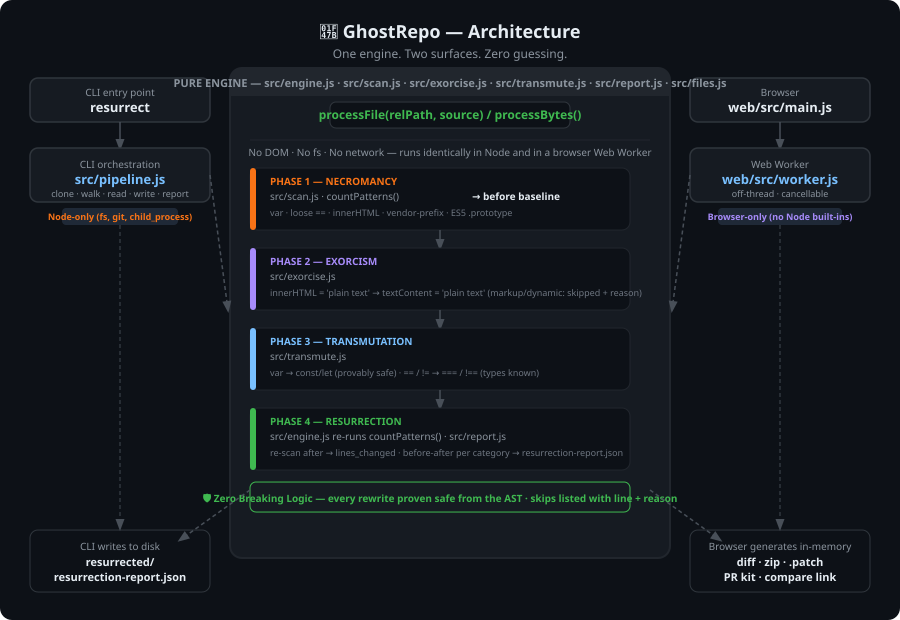

<div align="center">

# 👻 GhostRepo

### Raise dead JavaScript repositories.

Paste a GitHub link to an abandoned web app.  
GhostRepo checks whether it can rise, rewrites legacy patterns with codemods that only touch what is **provably safe**, runs the original and the resurrected app side by side, and hands you a patch and a ready-to-paste pull request.

<br/>

[](https://luciod3v.github.io/GhostRepo/)
&nbsp;
[](test/)
&nbsp;
[](https://kiro.dev)

<br/>

> **Kiroween Hackathon — Resurrection category**

</div>

---

## 💀 The problem

The internet is a graveyard of abandoned code: apps deleted from their repositories, frameworks that died, projects archived and left read-only. Much of that code still holds working logic, but it is written in syntax and patterns that nobody wants to touch anymore.

Automatic "modernizers" usually promise too much, and nobody merges a rewrite they cannot trust.

**GhostRepo takes the opposite bet:** it changes only what it can prove is safe, lists everything it left alone and why, and measures every number it reports.

---

## 🌐 Try the web app

**▶ https://luciod3v.github.io/GhostRepo/**

No login. No install. Paste a public GitHub URL and watch it come back to life.

```
https://github.com/LucioD3v/ghostrepo-gaia-calculator
```

The whole resurrection runs in your browser. No code is sent to any server of ours.

<details>
<summary><strong>How it works, step by step</strong></summary>
<br/>

1. **Assessment** — From the file listing alone, before anything is downloaded, GhostRepo tells you whether the repository can be resurrected. A JavaScript web project can. A Python, Java or PHP project cannot, and it says why. An archived repository is named as read-only before any work begins.

2. **Resurrection** — Files are fetched from GitHub and run through the engine in a background worker, so the page stays responsive and a new run cancels the old one.

3. **Results**, in four tabs:
   - **Code** — the modified code next to the original, with every skipped site marked and explained.
   - **Run** — the original and resurrected app running side by side in sandboxed frames.
   - **Download** — resurrected zip, JSON report, `.patch` file, and PR description.
   - **Pull request** — branch name, exact git commands ending in `gh pr create`, commit message, title and description — all generated from the measured report. Or type your username and **Open pull request on GitHub** opens GitHub's compare page with everything filled in.

</details>

---

## 🗺️ Architecture

<div align="center">
  
</div>

---

## 🔮 What the engine does

The engine ([`src/engine.js`](src/engine.js)) is **identical code** in the CLI and in the browser — built on [jscodeshift](https://github.com/facebook/jscodeshift) AST transforms. No regex rewrites. No guessing.

| Phase | Name | What happens |
|---|---|---|
| 1 | **Necromancy** | Scans the AST and counts five legacy patterns: `var`, loose `==`/`!=`, `innerHTML` assignments, vendor-prefixed APIs, ES5 `.prototype` assignments. |
| 2 | **Exorcism** | `el.innerHTML = 'plain text'` → `el.textContent = 'plain text'`. Markup or dynamic values: left alone and flagged. |
| 3 | **Transmutation** | `var` → `const`/`let`. `==`/`!=` → `===`/`!==` when both operand types are statically known. |
| 4 | **Resurrection** | Re-measures the transformed code, counts every change, and writes the report. |

### ✅ Rewritten today

- `var` → `const` / `let` (when scoping is provably unchanged)
- `==` → `===` and `!=` → `!==` (when both operand types are known)
- `innerHTML` with a plain-text literal → `textContent`

### 🔎 Reported, never rewritten

- Vendor-prefixed and deprecated DOM APIs (`MozTransform`, …)
- ES5 `.prototype` patterns
- `innerHTML` with markup or dynamic values
- Loose equality with unknown operand types

### 🛡️ Zero Breaking Logic

A rewrite is applied only when the syntax proves the behavior stays the same. Anything else is left as it was and **listed with its line and reason**. [`test/zero-breaking-logic.test.js`](test/zero-breaking-logic.test.js) runs the original and the transformed code of real legacy patterns in a fresh VM over the same inputs and requires identical results — exceptions included.

Files that are not valid UTF-8, or that the parser rejects, are skipped and listed, never silently dropped or rewritten.

---

## 🪦 Showcase: the Firefox OS Calculator

The Calculator app from [Gaia](https://github.com/mozilla-b2g/gaia), the HTML5 interface of Mozilla's Firefox OS, is *doubly dead*:

1. It was **deleted** from Gaia on 2012-12-27 (commit `53dd83d7`, *"Bug 822565 — Remove the calculator app"*).
2. The entire [`mozilla-b2g/gaia`](https://github.com/mozilla-b2g/gaia) repository was **archived (read-only) on 2021-11-03** when Mozilla discontinued Firefox OS.

The original source lives in [`LucioD3v/ghostrepo-gaia-calculator`](https://github.com/LucioD3v/ghostrepo-gaia-calculator). It is the first example on the web app.

| Metric | Value |
|---|---|
| Files scanned | 5 |
| Files transformed | 2 (`calculator.js`, `parser.js`) |
| Files skipped | 2 (test files the parser rejects, listed with reason) |
| Lines changed | 58 |
| Legacy patterns removed | **29** (28 `var`, 1 `innerHTML`) |

> The web app and the CLI produce **byte-identical output** for the same input.

> **Provenance:** Mozilla code under the Apache License 2.0 (Copyright 2012, Mozilla Foundation).

---

## 🔁 CLI

The same engine runs from the command line against a Git repository URL or a local folder:

```bash
npm ci
node resurrect <repo-url-or-path> [--path <subfolder>]
```

```bash
# The showcase
node resurrect https://github.com/LucioD3v/ghostrepo-gaia-calculator --path legacy
```

On macOS/Linux `./resurrect` works too. The CLI clones the repository, rewrites its files, and writes `resurrection-report.json`. Full design in [`docs/RESURRECT-CLI.md`](docs/RESURRECT-CLI.md).

---

## 🧪 Development

```bash
npm ci
npm test            # unit and integration tests (node:test) — 155 pass
npm run web         # build dist/ and serve at http://localhost:8080
npm run e2e:web     # end-to-end in real Chrome against GitHub (needs Chrome + network)
```

**Deploying.** [`.github/workflows/pages.yml`](.github/workflows/pages.yml) runs tests and build on every PR, and publishes `dist/` to GitHub Pages on every push to `main`. One-time setup: *Settings → Pages → Source: GitHub Actions*.

---

## 👻 Built with Kiro

The `.kiro/` folder holds how the project is steered, specified, and guarded:

| Layer | What's there |
|---|---|
| **Steering** ([`.kiro/steering/`](.kiro/steering/)) | `architecture` (always), `product`, `tech`, `structure` — accurate maps of the codebase. `zero-breaking-logic` (active for `src/` and `test/`) and `web-security` (active for `web/`) — actionable rules grounded in the actual module names and patterns. |
| **Specs** ([`.kiro/specs/`](.kiro/specs/)) | `resurrect-web-ui` (the full web app feature), `open-pull-request` (one-click PR and archived-repo detection, requirements → design → tasks committed before code), and two CLI bugfix specs. All four are complete with `.config.kiro`, requirements, design, and tasks. |
| **Hooks** ([`.kiro/hooks/`](.kiro/hooks/)) | `zero-breaking-logic-tests` runs `npm test` when engine or test code is saved. `web-build-check` rebuilds bundles when web code changes. `guard-legacy-sources` blocks any agent write to `legacy/` or `fixtures/` — recovered code is the evidence every resurrection is measured against. `transform-safety-review` reviews session changes against the steering rules when the agent stops. |

---

## 🏗️ Project structure

```
GhostRepo/
├── resurrect              # CLI entry point
├── src/                   # Shared engine (pure: CLI + browser Web Worker)
│   ├── engine.js          #   processFile() / processBytes(): scan → exorcise → transmute → re-scan
│   ├── scan.js            #   Necromancy: AST pattern counter
│   ├── exorcise.js        #   Exorcism: innerHTML → textContent
│   ├── transmute.js       #   Transmutation: var → const/let, == → ===
│   ├── pipeline.js        #   CLI I/O: clone, walk, transform, write, report
│   └── files.js, walk.js, report.js
├── web/                   # Browser-only web app
│   ├── index.html, style.css
│   ├── src/               #   GitHub client, assessment, worker, diff, preview, zip, PR kit and link
│   └── shims/             #   Tiny stubs for Node modules the bundle never executes
├── scripts/               # build-web, serve-web, e2e-web, guard-legacy (Kiro hook script)
├── test/                  # node:test suites (155 pass, 1 skipped)
├── fixtures/              # legacy-sample.js
├── docs/RESURRECT-CLI.md  # CLI design document
└── .kiro/                 # Kiro steering, specs and hooks
```

---

## 📜 License

GhostRepo is released under the [MIT License](LICENSE). Resurrected projects keep their **original upstream license**.

---

<div align="center">

## 🏆 Kiroween Hackathon — Resurrection

Developed by **Vicente Guzmán**

*Scan the dead. Banish the bugs. Bring the code back to life.* 👻

</div>
